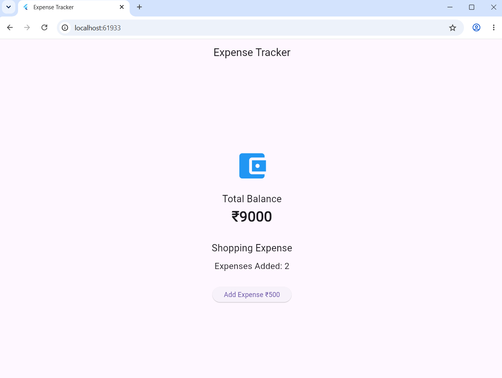
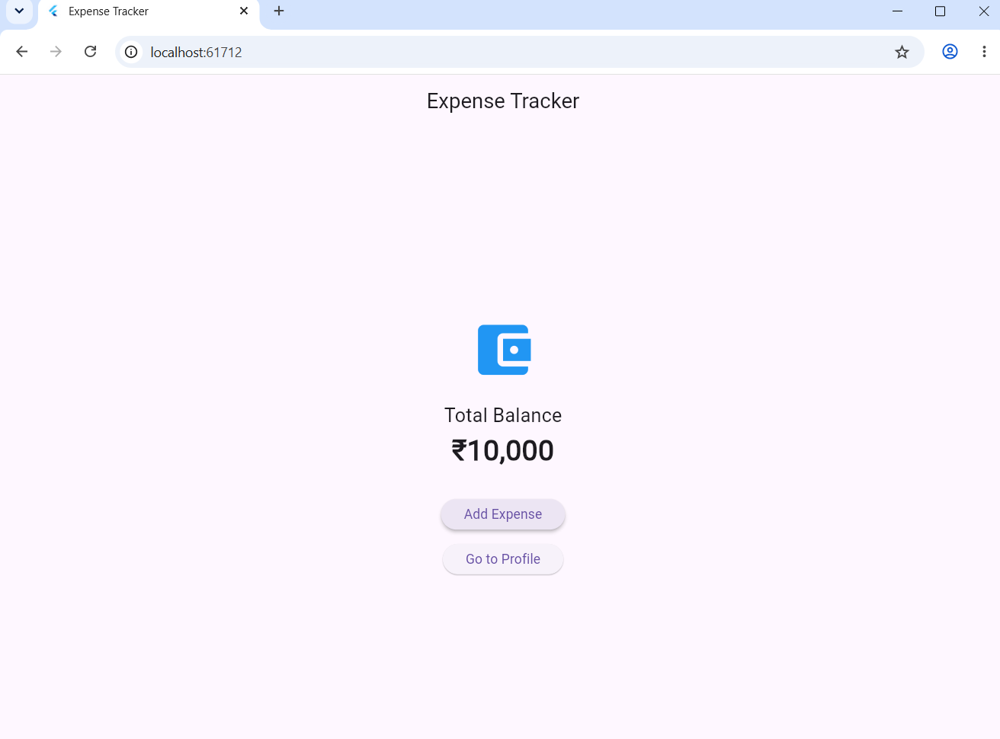
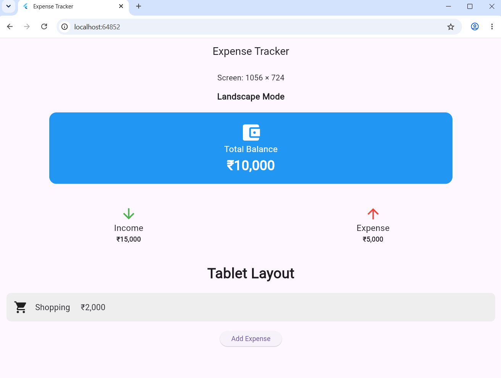
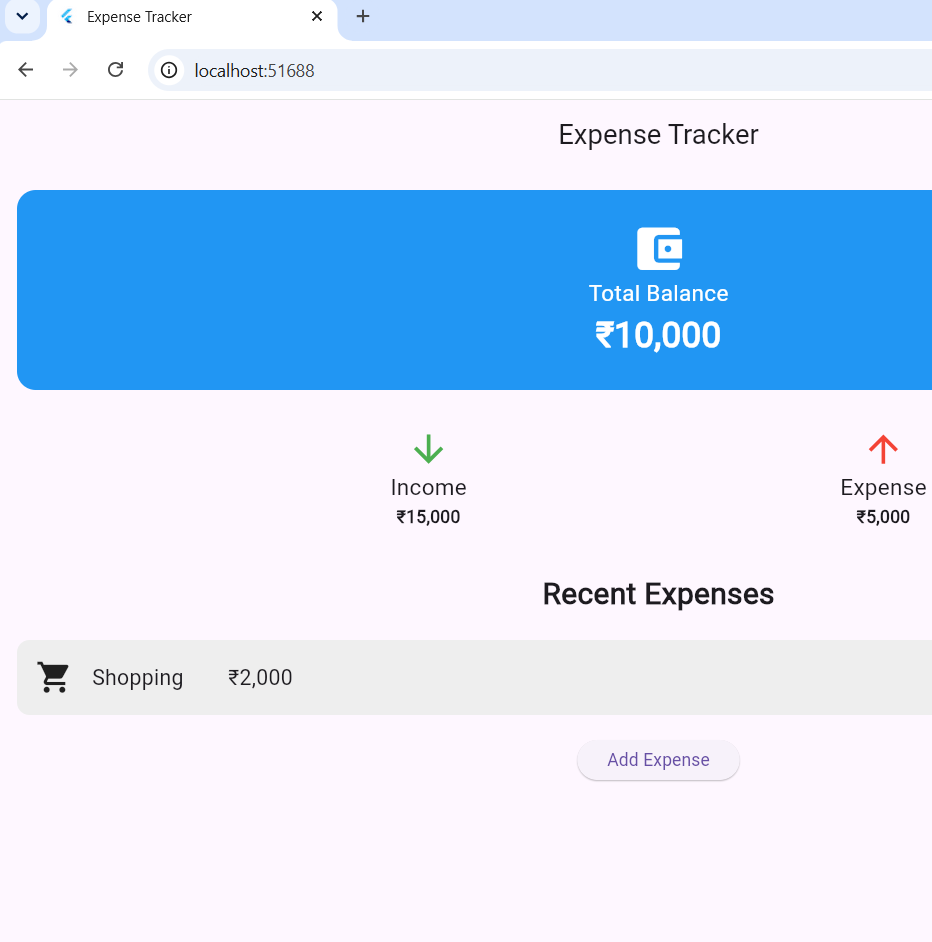
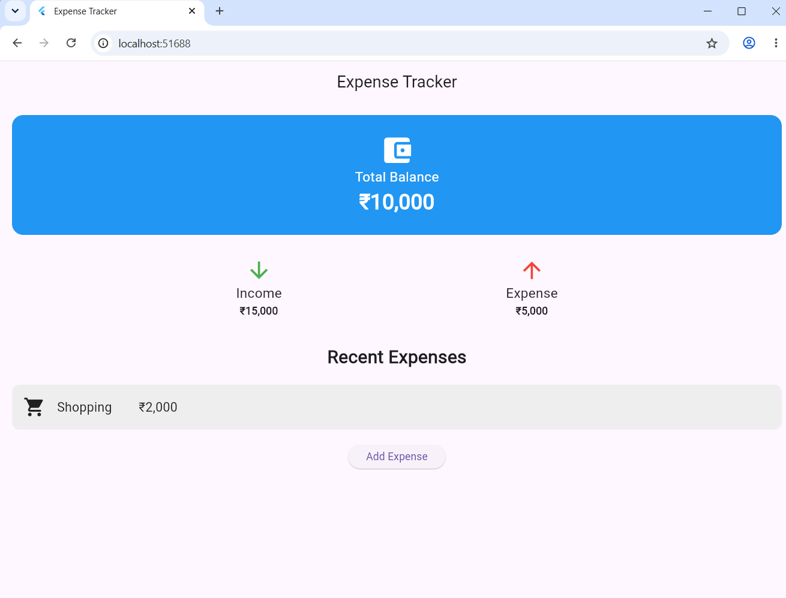
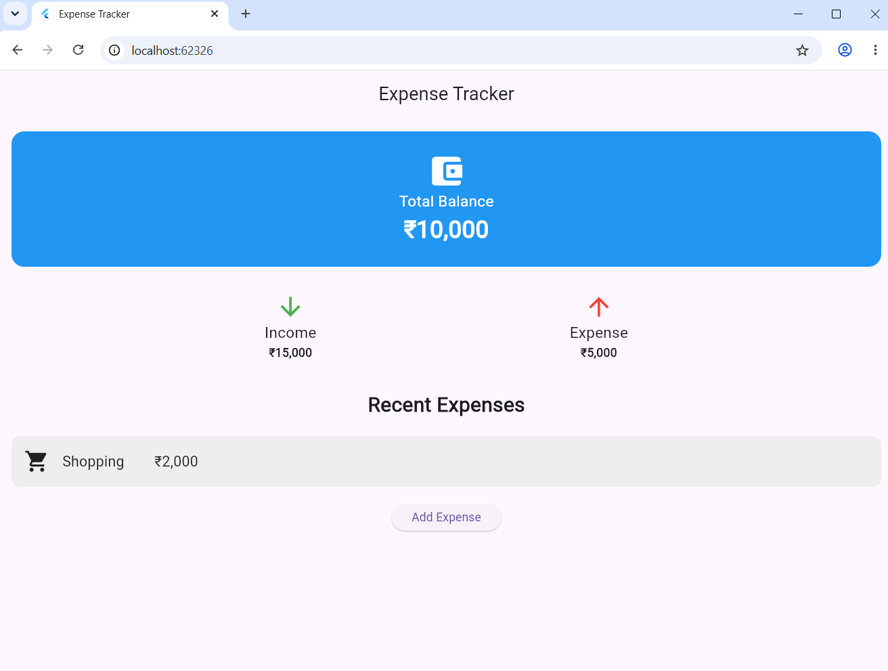

Expense Tracker App Using Flutter

Project Overview

This project is developed using Flutter and Dart as part of the CS506PC UI Design (Flutter Lab). It demonstrates Flutter UI design, reusable widgets, form validation, animations, REST API integration, and widget testing through an Expense Tracker application.

Technologies Used

- Flutter
- Dart
- Visual Studio Code
- REST API
- HTTP package
- Git and GitHub

Experiments

Experiment 1: Flutter Setup and Dart Basics

Objective: To set up the Flutter development environment and understand basic Dart programming.

What I Did:

- Set up Flutter and configured the development environment.
- Learned basic Dart syntax and program structure.
- Ran the initial Flutter application.

Screenshot:

"Experiment 1" (screenshort/experiment1.png)

Experiment 2: Basic Flutter UI Widgets

Objective: To design an expense-tracking interface using basic Flutter widgets.

What I Did:

- Used Text, Container, Icon, Row, and Column widgets.
- Designed the basic expense-tracking interface.
- Organized the UI elements into a structured layout.

Screenshot:

"Experiment 2" 

Experiment 3: Responsive UI Design

Objective: To make the application suitable for different screen sizes.

What I Did:

- Used responsive layout techniques.
- Arranged expense information using Flutter layout widgets.
- Adjusted the interface according to available screen space.

Screenshot:

"Experiment 3" 

Experiment 4: Navigation Between Screens

Objective: To implement navigation between screens in the Flutter application.

What I Did:

- Implemented screen navigation using Flutter navigation techniques.
- Organized the application screens for better usability.

Screenshot:

"Experiment 4" 

Experiment 5: State Management

Objective: To update the user interface when application data changes.

What I Did:

- Explored state management in Flutter.
- Used stateful widgets and state updates to manage changing data.

Screenshot:

"Experiment 5" 

Experiment 6: Custom Widgets and Themes

Objective: To improve code reusability and maintain a consistent application design.

What I Did:

- Created reusable widgets such as ExpenseCard and SummaryCard.
- Applied a consistent theme, colors, and styling.
- Displayed expense information using custom UI components.

Screenshot:

"Experiment 6" 

Experiment 7: Form Validation

Objective: To validate expense details entered by the user.

What I Did:

- Created an expense-entry form.
- Added input fields for expense title, amount, and category.
- Implemented form validation to prevent invalid entries.
- Updated the expense list and total when an expense was added.

Screenshot:

"Experiment 7" 

Experiment 8: Flutter Animations

Objective: To add animations and improve the user experience.

What I Did:

- Used AnimatedContainer to demonstrate animated UI changes.
- Used AnimatedOpacity to show or hide expense details.
- Added animated transitions to the expense summary interface.

Screenshot:

"Experiment 8" 

Experiment 9: REST API Integration

Objective: To fetch and display data from a REST API.

What I Did:

- Added the HTTP package to the Flutter project.
- Sent a GET request to the JSONPlaceholder REST API.
- Retrieved sample post data from the API.
- Displayed the retrieved data in the application.
- Added loading, error, and retry functionality.

Screenshot:

"Experiment 9" 

Note: The API provides sample post data for demonstration; it does not retrieve actual financial transactions or save real expenses.

Experiment 10: Testing and Debugging

Objective: To test the Flutter application using widget testing.

What I Did:

- Created a widget test in "test/widget_test.dart".
- Tested whether the application's root widget loads successfully.
- Executed the test using the Flutter testing command.
- Verified that the test passed successfully.

Test Command:

flutter test

Screenshot:

"Experiment 10" 

How to Run the Project

1. Install Flutter and configure the development environment.
2. Clone or download this repository.
3. Open the project folder in Visual Studio Code.
4. Install the required dependencies:

flutter pub get

5. Run the application:

flutter run

6. Run the widget tests:

flutter test

Conclusion

This project helped develop an understanding of Flutter UI widgets, responsive layouts, reusable components, form validation, animations, REST API integration, and widget testing. It demonstrates the implementation of an Expense Tracker interface using Flutter and Dart.

Repository Structure

expense_tracker/
├── lib/
│   └── main.dart
├── test/
│   └── widget_test.dart
├── screenshots/
│   ├── experiment1.png
│   ├── experiment2.png
│   ├── experiment3.png
│   ├── experiment4.png
│   ├── experiment5.png
│   ├── experiment6.png
│   ├── experiment7.png
│   ├── experiment8.png
│   ├── experiment9.png
│   └── experiment10.png
├── pubspec.yaml
└── README.md
